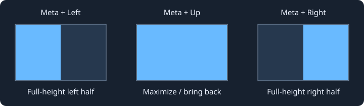
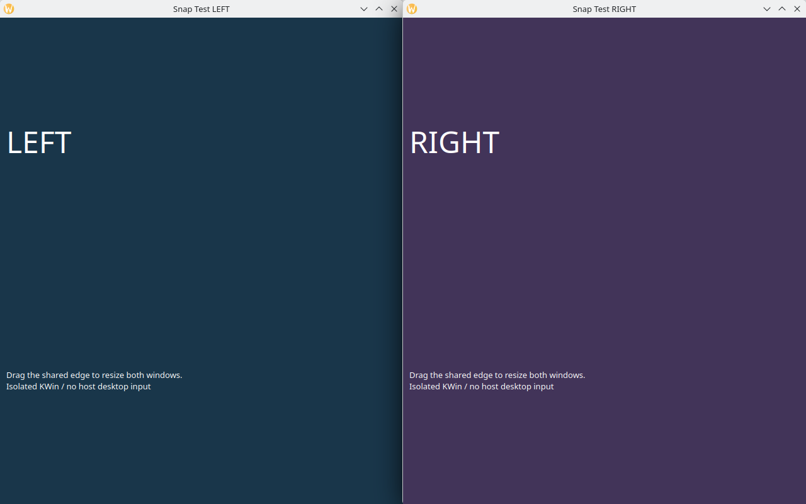
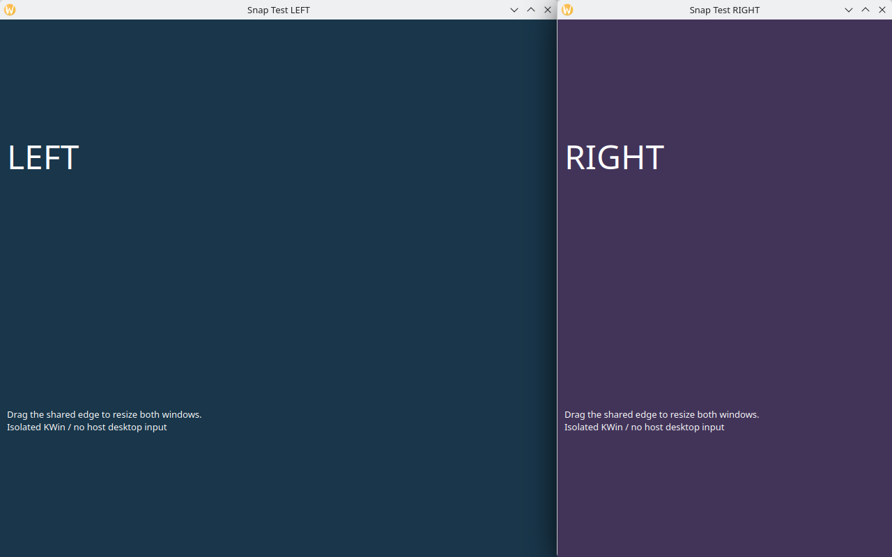

# kde-window-snap

KDE Plasma用、ウィンドウスナップを自然にするスクリプト

**↓で一時的に隠して、↑で取り戻す。左右に並べたら、境界ドラッグで幅を調整する。**
KWin標準のショートカットを置き換える、小さなJavaScriptスクリプトです。
MetaはWindowsキーです。



注：操作の模式図です。左右配置・最大化の範囲は、パネルを除く利用可能領域です。

## 操作

| キー | 動作 |
|---|---|
| **Meta + ↑** | 最大化。↓で記憶したウィンドウがあれば復元して最大化 |
| **Meta + ↓** | 現在のウィンドウを一発で最小化し、復帰対象として記憶 |
| **Meta + ← / →** | 今いるディスプレイの左右タイルへ、高さいっぱいに配置（初期比率50:50） |
| **中央の境界をドラッグ** | 左右の幅を連動して調整。一方を広げた分、もう一方が縮む |

- Metaを離しても復帰対象を保持するため、背後を見てから↑で戻せます。
- 上半分・四隅の配置から左右キーを押しても、高さを半分のまま引き継ぎません。
- ↑や同じ左右キーを繰り返しても、配置解除や隣の画面への移動はしません。
- 境界調整後の左右キーは、調整済みの比率を維持します。
- ↓を再び押すと、その時点のアクティブウィンドウを最小化し、復帰対象を更新します。
- 左右キーは復帰対象を解除し、現在のアクティブウィンドウを配置します。

### 境界ドラッグの実例

左右キーで2つのウィンドウを配置し、接している端にポインターを合わせてドラッグします。
KWin標準の左右タイルを使うため、Meta + Tのカスタムレイアウトは変更しません。

| ドラッグ前：640 + 640 px | ドラッグ後：800 + 480 px |
|---|---|
|  |  |

注：同じ1280×800の隔離KWinで撮影した実際のスクリーンショットです。
境界を動かしても合計幅1280pxと全体の高さは変わりません。

## 必要な環境

- KDE Plasma 6 / KWin（**Plasma 6.6.6・Waylandで確認済み**）
- ディストリビューション標準のPython 3と`python3-dbus`
- `kwriteconfig6`（KDE Frameworks 6の設定ツール）

Pythonはインストール・復元時だけ使用します。動作中に外部の常駐プロセスは不要です。
別バージョンのPlasma、X11、複数画面での実機動作は未確認です。

## インストール

Plasmaにログインした通常ユーザーのターミナルで実行します。`sudo`は不要です。

```sh
git clone https://github.com/novelsavage/kde-window-snap.git
cd kde-window-snap
/usr/bin/python3 manage.py install
```

必要なファイルを`~/.local/share/kwin/scripts/windows-snap/`に配置し、その場で有効化します。
`XDG_DATA_HOME`を指定している場合はそちらを使います。
次回ログイン向けの有効設定も保存します。再ログイン自体の検証は未実施です。

標準のMeta + 矢印4つを無効にし、このスクリプトの操作を割り当てます。
変更前のキー設定は`~/.local/share/kwin/windows-snap-backup/shortcuts.json`に保存します。
再インストールでは既存の復元用バックアップを上書きしません。

更新時は`git pull`後、もう一度`manage.py install`を実行します。
更新するとセッション内の復帰対象の記憶はリセットされます。

## 元に戻す・削除する

元のキー割り当てへ戻す（ファイルは残す）：

```sh
/usr/bin/python3 manage.py restore
```

元のキー割り当てへ戻し、インストール先のファイルも削除する：

```sh
/usr/bin/python3 manage.py uninstall
```

クローンしたディレクトリを削除済みでも、インストール先から復元できます。

```sh
/usr/bin/python3 ~/.local/share/kwin/scripts/windows-snap/manage.py restore
```

復元するのは、この機能が管理するショートカットのみです。他のKDE設定は上書きしません。
この機能の使用中に管理対象のキーを手動変更した場合も、復元時は導入前の割り当てに戻します。

## 復帰対象の扱いと制約

最小化時の自動的なフォーカス移動では記憶を保持し、**その後に別のウィンドウへ
アクティブ状態が変わると解除**します。仮想デスクトップ・アクティビティの変更、
対象ウィンドウの終了でも解除します。

ただし、最小化後に自動でアクティブになった背後のウィンドウは、クリックしても
アクティブ状態が変わりません。そのウィンドウをクリックしたり文字入力したりしても
復帰対象が残り、↑は元のウィンドウを復帰させます。
アプリによる自動的なアクティブ変更でも、記憶が解除されることがあります。
復帰対象はKWinセッション内だけで記憶します。

左右配置はKWin標準のクイックタイルに参加します。比率は画面・仮想デスクトップごとの
標準タイルで共有され、他の標準スナップにも影響します。
同じ側に複数ウィンドウを置いた場合は重なり、そのタイルに属するウィンドウが一緒にリサイズされます。
左右・四隅の標準タイルがすべて空になると、KWinが比率を初期化します。比率は永続保存しません。
最小サイズ・固定サイズ・文字セルの刻みなど、アプリ側の制約で配置結果が多少ずれる場合があります。
Windowsのウィンドウスナップを完全再現するものではありません。

## 開発・検証

```sh
node tests/state.test.cjs
/usr/bin/python3 -m unittest discover -s tests -p 'test_*.py'
```

実KWinではテスト用Konsoleを使い、左上配置からの左右配置、同方向の繰り返し、
最小化後の復元・最大化、別ウィンドウ選択後の動作、対象の終了を確認しています。
インストール・更新・復元・再インストールも実環境で確認済みです。
配布処理の自動テストでは、新規導入、バックアップ保持、設定復元、
割り当て失敗時のロールバック、不正なバックアップの拒否を検証しています。

v1.1の連動リサイズは、**独立したD-Bus・設定・Waylandソケットを持つヘッドレスKWin**と
テスト用Qtアプリで検証しています。作業中のデスクトップには入力しません。
実ポインタードラッグと前後の形状、比率保持、最大化・復帰の回帰を確認しています。
再現手順とCua Driverの検証結果は[隔離GUIテスト](docs/TESTING.md)を参照してください。

実装で参照したAPI：
[KWin 6.6 Workspace](https://github.com/KDE/kwin/blob/Plasma/6.6/src/scripting/workspace_wrapper.h)、
[Window](https://github.com/KDE/kwin/blob/Plasma/6.6/src/window.h)。

## ライセンス

[MIT](LICENSE)
